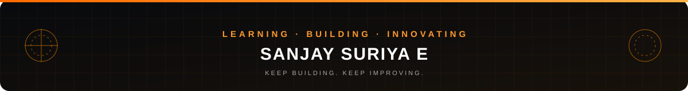

**Computer Science Student &nbsp;|&nbsp; AI Enthusiast &nbsp;|&nbsp; App Developer &nbsp;|&nbsp; Aspiring AI Engineer**

---

## About Me

I'm **Sanjay Suriya E**, a B.E. Computer Science and Engineering student at **Paavai Engineering College** in Namakkal, Tamil Nadu. I'm learning programming through Python, C and C++, exploring artificial intelligence, and building applications to turn what I learn into something practical.

My aim is to grow into an AI Engineer, one project and one problem at a time.

<table>
  <tr>
    <td width="50%" valign="top">
      <b>Currently</b> 
      Building <b>ONE7</b> 
      Exploring artificial intelligence 
      Practising problem solving on LeetCode
    </td>
    <td width="50%" valign="top">
      <b>Quick facts</b> 
      Based in Namakkal, Tamil Nadu, India 
      B.E. CSE, batch 2025–2029 
      Languages: Python, C, C++
    </td>
  </tr>
</table>

---

## Education

<table>
  <tr>
    <td><b>College</b></td>
    <td>Paavai Engineering College</td>
  </tr>
  <tr>
    <td><b>Degree</b></td>
    <td>Bachelor of Engineering (B.E.)</td>
  </tr>
  <tr>
    <td><b>Department</b></td>
    <td>Computer Science and Engineering</td>
  </tr>
  <tr>
    <td><b>Academic period</b></td>
    <td>2025–2029</td>
  </tr>
  <tr>
    <td><b>Location</b></td>
    <td>Namakkal, Tamil Nadu, India</td>
  </tr>
</table>

---

## Technical Skills

**Programming languages**

**Tools and platforms**

*Frontend, backend and database skills will be added here as my projects demonstrate them.*

---

## Featured Project: ONE7

**ONE7** is the application I'm currently building.

**Status:** In development

A public repository, feature list and screenshots will be added here once ONE7 is ready to share.

<!--
  ONE7 TEMPLATE: fill this in only with what is actually implemented, then delete this comment.

  **What it is:** one honest sentence on what ONE7 does and who it is for.
  **Problem it addresses:** ...
  **Implemented features:**
  - ...
  **Built with:** languages, frameworks and tools actually used
  **Links:** [Repository](https://github.com/sanjaysuriya23/ONE7) · [Demo](...)
  
-->

---

## GitHub Contribution Graph

---

## GitHub Statistics

  
  

---

## Coding Profiles

  
  
  
  
  

  <a href="https://github.com/sanjaysuriya23">GitHub</a> ·
  <a href="https://leetcode.com/u/sanjaysuriya23/">LeetCode</a> ·
  <a href="https://www.linkedin.com/in/sanjay-suriya-6b354b427/">LinkedIn</a> ·
  <a href="https://www.instagram.com/sanjaysuriya23/">Instagram</a> ·
  <a href="mailto:sanjaysuriya232006@gmail.com">sanjaysuriya232006@gmail.com</a>

---

## Career Goal

I want to become an **AI Engineer**. For now that means building a strong foundation in programming and computer science, exploring how artificial intelligence works, building useful applications like ONE7, and improving my skills with every project.

---

